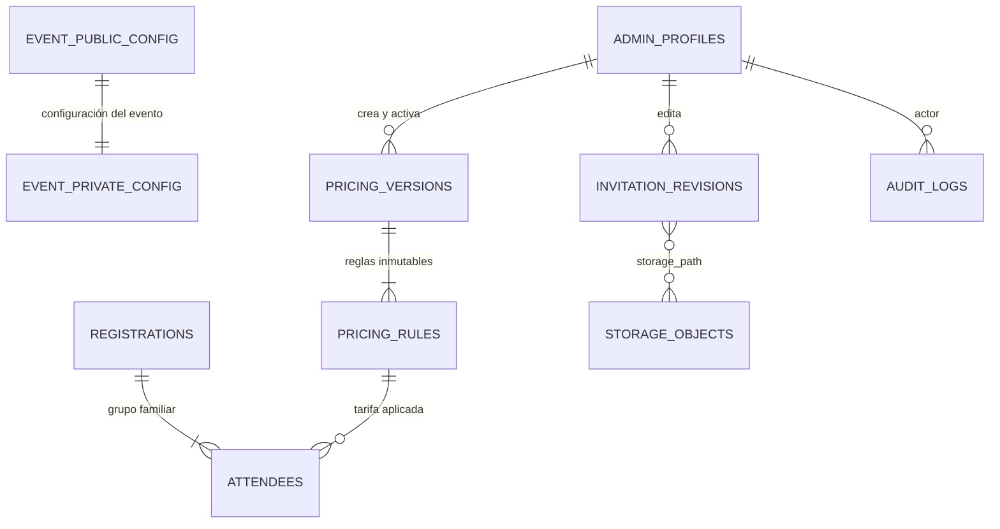

# Propuesta de arquitectura — Supabase / Tarjeta de Casamiento

**Etapas:** auditoría local y propuesta de arquitectura.  
**Fecha:** 2026-11-06  
**Decisiones definitivas:** evento 26/09/2027; nuevo proyecto/base vacía; Supabase PostgreSQL; saldo pendiente sin registros de pagos; guardar solo edad al evento; React + TypeScript + Vite.  
**Estado:** para revisión. Este documento no es SQL ni autorización para implementar.

## 1. Resumen ejecutivo

Se propone reemplazar el modelo de pagos actual por saldos calculados, separar información pública y privada, restringir toda escritura administrativa mediante RLS y RPC, guardar el historial tarifario inmutable y conservar el esquema JSON del editor. La confirmación pública se protege con una Edge Function, CAPTCHA validado en servidor, rate limiting persistente, normalización e idempotencia.

No se migra el esquema remoto anterior ni se recuperan sus datos. No se crea `payment_records`, no se registran pagos ficticios ni estados como `informed`, `verified` o `paid`. La tarifa aplicada por persona es un snapshot inmutable que determina el saldo correspondiente. Las bajas administrativas son lógicas y restaurables.

**Tarifas oficiales:**

| Categoría | Precio |
|---|---:|
| Adulto desde el comienzo | ARS 130.000 |
| Bebé de 0 a 1 año | ARS 0 |
| Niño de 2 a 10 años | ARS 50.000 |
| Adulto después del almuerzo | ARS 70.000 |

El documento de propuesta anterior no estaba presente al iniciar esta revisión. Con autorización expresa del usuario, se reconstruyó y actualizó a partir de la versión anterior de esta conversación.

## 2. Etapa A — estado local

### Git y preservación

- Rama: `master`.
- HEAD: `a497bbf024b8371ee83694bf70aeaf35610d879c`.
- Al inicio de esta tarea: **22 archivos rastreados modificados y 53 rutas sin seguimiento**.
- Entre las modificaciones rastreadas están aplicación, tipos, configuración y migraciones `001`–`003`.
- Entre los archivos sin seguimiento están `005_invitation_editor.sql`, el editor, pruebas, recursos, copias de respaldo, evidencias y la auditoría previa.
- La propuesta que debía actualizarse no aparecía en disco ni en `git status`; fue reconstruida tras pedir autorización. Ninguno de los otros cambios fue descartado, movido ni sobrescrito.
- No se consultó Supabase, Auth ni Storage remoto.

### Hallazgos locales que motivan el rediseño

1. El árbol de trabajo no equivale al contenido de HEAD; la arquitectura se evalúa contra el código local actual y la [auditoría previa](./AUDITORIA_COMPLETA_SUPABASE_TARJETA_CASAMIENTO.md).
2. `supabaseClient.ts` usa `SupabaseClient<any>` y los tipos actuales no cubren todos los RPC/tablas.
3. El cliente hace escrituras directas a varias tablas, incluida auditoría.
4. `registrar_confirmacion` calcula en servidor, pero también inserta un `payment_records` `informed` aunque la confirmación no pruebe un pago.
5. El email actual se protege con un índice que no incorpora `btrim`; los controles de cliente no resuelven carreras concurrentes.
6. Tarifas e historial se escriben en operaciones separadas y la tabla no evita categorías activas duplicadas.
7. `audit_logs.record_id` es UUID, pero algunos usos envían una cadena vacía o claves de configuración.
8. El bucket actual está marcado público, con lo que la lectura pública no queda limitada a recursos referenciados por una publicación.
9. El panel existente incluye vistas y resúmenes de pagos que deben convertirse en saldos.
10. `gallery_images` y `content_sections` figuran en migraciones, pero no se encontraron consumidores del frontend actual.
11. Los defaults de fecha y los tests existentes tienen referencias distintas; para esta arquitectura prevalece la fecha oficial de 26/09/2027.

La auditoría local no inspeccionó el estado remoto, Auth, datos, RLS efectivo ni objetos de Storage. No se presume que el esquema remoto previo esté intacto ni aplicado.

## 3. Modelo de datos y relaciones

Nombres conceptuales para revisión; no son contratos ni migraciones definitivas.

`STORAGE_OBJECTS` representa objetos en Supabase Storage, no una tabla propia de `public`.

### `event_public_config`

Una única configuración de invitación pública: fecha (26/09/2027), horarios, lugar, dirección, fecha límite de RSVP, vestimenta y textos públicos. La tabla base no es legible por anon; una RPC pública devuelve solo campos aprobados.

Contiene además alias, titular y banco, separados de información administrativa privada, y un indicador explícito de publicación administrado solo por owner. El editor puede modificar los demás campos públicos; los tres datos bancarios y su indicador de publicación son owner-only. La RPC pública incluye esos tres campos únicamente cuando el owner los habilitó. **No se guarda ni publica CVU/CBU.** No se expone la fila completa.

### `event_private_config`

Configuración interna, notas de operación y datos que no deban llegar a visitantes. Acceso solo owner mediante operaciones autorizadas. Nunca se combina con la respuesta pública ni se entrega con una consulta genérica.

### `registrations`

Inscripción y responsable del grupo:

- UUID, nombre/apellido del responsable, email recibido, email normalizado, teléfono si se necesita.
- `rsvp_status`: `pending`, `confirmed`, `declined` o `cancelled`.
- `request_id` para idempotencia, timestamps y campos de baja lógica.

Una familia se identifica por la inscripción, no por apellido. Una única inscripción por correo se impone con índice único sobre `lower(btrim(email_normalized))` (o una columna canónica equivalente), además de normalización y validación en servidor. La restricción de base de datos resuelve solicitudes concurrentes. Los duplicados devuelven respuesta genérica sin filtrar datos de la inscripción previa.

### `attendees`

Una persona por fila, asociada obligatoriamente a `registration_id`:

- nombre y apellido;
- `age_at_event`, entero entre 0 y 120, que representa edad **al 26/09/2027**;
- `after_lunch`, asistencia individual y categoría calculada en servidor;
- referencia a la regla/version tarifaria aplicada y snapshot del precio.

No se almacena fecha de nacimiento. La UI aclara que debe informarse la edad que la persona tendrá el día del evento. Cliente no puede imponer categoría ni precio.

### `pricing_versions` y `pricing_rules`

`pricing_versions` contiene número secuencial, autor, fecha y motivo; las versiones publicadas son inmutables. `pricing_rules` almacena cuatro categorías estables como claves deterministas (`bebe`, `nino`, `adulto`, `post-almuerzo`), precio ARS y relación única por versión/categoría. Una referencia única selecciona la versión vigente.

Un RPC owner-only crea y activa una nueva versión en una transacción, valida que tenga exactamente las cuatro categorías, importes no negativos y moneda ARS, mueve la referencia vigente y registra auditoría. La primera versión debe usar exactamente los cuatro precios oficiales de este documento; cambios futuros requieren nueva versión y aprobación owner. La activación y el log se confirman juntos. El editor no puede modificar, crear ni activar tarifas.

Cada asistente conserva `pricing_version_id`, categoría y `price_applied`; una FK compuesta a la regla/version/precio asegura consistencia. Al cambiar tarifas futuras, los snapshots previos no cambian. Las versiones con referencias no se borran.

### Saldos

No existe una tabla de pagos. El saldo familiar es la suma del precio snapshot de asistentes activos que asisten, siempre que la inscripción esté confirmada y activa. Una consulta devuelve:

- importe de cada asistente;
- total familiar correspondiente a abonar;
- cantidad de asistentes incluidos;
- desglose de exclusiones por RSVP/baja, sin marcar pagos.

La interfaz lo denomina “saldo a abonar” o “importe correspondiente”. No presenta “pagado”, “verificado”, “informado” ni importes recibidos.

### `admin_profiles`

Perfil vinculado a `auth.users.id`, email verificado, rol `owner`/`editor`, estado activo y fechas. La autorización se basa en `auth.uid()` y perfil/rol consultado por backend, nunca en un email o rol mandado por navegador.

Cuentas previstas: `matymoya18@gmail.com` owner y `priscila.moya@mi.unc.edu.ar` editor. No se presupone que existan en Auth del nuevo proyecto.

### `audit_logs`

Campos conceptuales:

- `actor_type`: `admin`, `guest` o `system`;
- `actor_id uuid nullable` (ID Auth para admin; ID de inscripción para guest; null para system);
- acción, tipo de entidad, `record_id uuid nullable`, `entity_key text nullable`;
- `request_id`, origen, fecha, `old_data` y `new_data` opcionales.

Una restricción valida actor/origen e impide que `record_id` y `entity_key` sean ambos incompatibles o strings vacíos. `actor_id` es polimórfico y no tendrá FK ambigua; las operaciones controladas validan actor en su contexto. Las operaciones administrativas obtienen actor de `auth.uid()`. RSVP usa el ID de inscripción que acaba de crear y origen `public_rsvp`. Procesos automatizados usan `actor_type=system`, sin suplantar admin.

Los logs guardan solo cambios necesarios; se excluyen email, teléfono, nombres completos y otros datos personales salvo que una necesidad de auditoría aprobada lo justifique. El navegador no tiene CRUD directo de logs. Todo cambio y su evento de auditoría son atómicos; falla del log implica rollback de la operación.

### `rsvp_rate_limits`

Tabla privada para control persistente por ventana: hash HMAC de IP (con secreto servidor), inicio de ventana, contador y expiración. No almacena IP cruda, email ni payload, y no está disponible por consultas de navegador. La Edge Function deriva el hash desde metadatos de red confiables; una función atómica incrementa/verifica contadores ante concurrencia. Una tarea controlada puede purgar filas vencidas sin registrar identificadores personales.

### `invitation_revisions`

Mantiene borradores, publicaciones e historial en JSONB versión 1 compatible con el editor existente: textos, momentos, imágenes por `storage_path`, visibilidad, colores, encuadres, música y versículo.

- A lo sumo un borrador activo y una publicación vigente, con índices parciales únicos.
- Autor, número de versión y fechas.
- El JSON nunca contiene URL firmada permanente.
- Validación en cliente para UX y repetida en backend como autoridad.
- Escritura optimista mediante `updated_at` y bloqueo transaccional.
- Publicación: valida, bloquea, archiva la vigente, publica borrador y audita en una transacción. Error en cualquier paso revierte todo.
- Lectura pública solo de la publicación actual; historial y borradores solo de admins.

### Bajas lógicas de grupos y personas

Tanto `registrations` como `attendees` tienen `deleted_at`, `deleted_by` (admin UUID), `deletion_reason` opcional. Una restricción exige que `deleted_at` y `deleted_by` sean ambos nulos o ambos estén definidos. Al restaurar se limpian esos campos de baja; el historial completo de bajas/restauraciones queda en `audit_logs`. Se conservan filas; no hay borrado físico automático ni cascadas destructivas. La baja/restauración se hace por RPC transaccional.

- **RSVP `declined`/`cancelled`:** respuesta o cambio de asistencia; conserva la inscripción y no equivale a baja administrativa. No se incluye en el saldo si no corresponde asistencia.
- **Baja administrativa:** oculta la fila de la operación normal, no borra el RSVP ni la historia. Excluye del saldo activo.
- Dar de baja a una persona no afecta a familiares; dar de baja al grupo no cambia físicamente a sus asistentes, pero excluye al grupo completo del saldo/consultas activas.
- Restaurar una persona conserva su `price_applied` snapshot y no crea otra fila. **No se puede restaurar una persona mientras su grupo siga dado de baja**; primero se restaura explícitamente el grupo. Restaurar el grupo no reactiva automáticamente integrantes dados de baja individualmente.
- Al restaurar se recalcula el saldo derivado con snapshots históricos, nunca con la tarifa vigente.
- Eliminación física: no disponible en la UI/RPC ordinaria; cualquier retención excepcional requiere proceso separado, autorización y registro.

## 4. Edad, categorías, tarifas y cálculo

La base de datos calcula categoría y precio; el frontend solo previsualiza con la misma regla:

1. Edad 0–1 al 26/09/2027: bebé, ARS 0.
2. Edad 2–10: niño, ARS 50.000 aunque llegue después del almuerzo.
3. Edad 11 o más y desde el comienzo: adulto, ARS 130.000.
4. Edad 11 o más después del almuerzo: adulto después del almuerzo, ARS 70.000.

Se valida rango de edad, categoría, horario, versión vigente y monto contra regla inmutable. El cliente no envía precio confiable. No asistente/grupo declinado o cancelado/grupo o persona con baja administrativa queda fuera del saldo activo según las reglas de la sección 3. Restaurar usa el snapshot conservado.

## 5. Roles, bootstrap y autorización

### Matriz definitiva de capacidades

| Operación | Editor | Owner |
|---|---:|---:|
| Consultar, crear y editar inscripciones administrativas | Sí | Sí |
| Dar de baja/restaurar inscripciones | Sí | Sí |
| Editar, dar de baja/restaurar asistentes | Sí | Sí |
| Consultar saldos | Sí | Sí |
| Editar invitación, guardar borradores y publicar | Sí | Sí |
| Consultar auditoría | Sí | Sí |
| Modificar tarifas o activar versiones tarifarias | **No** | Sí |
| Modificar roles administrativos | **No** | Sí |
| Leer/modificar configuración privada | **No** | Sí |
| Modificar configuración crítica de seguridad | **No** | Sí, mediante procedimiento controlado |

Ningún rol de navegador tiene `DELETE` físico ordinario. La UI puede ocultar controles, pero PostgreSQL/RPC determina el permiso real.

### Bootstrap inicial de owner

No se insertan usuarios Auth, contraseñas ni perfiles owner en seeds/migraciones; no existe RPC pública para elevar privilegios. El primer owner requiere operación manual y controlada por quien administra el proyecto:

1. Crear/invitar al usuario por el flujo oficial Auth; no compartir ni almacenar su contraseña en SQL.
2. Verificar en Auth que la cuenta existe, tiene el email esperado y `email_confirmed_at` no es nulo.
3. En una sesión de confianza de operador del proyecto (dashboard/SQL editor bajo control del responsable), validar la identidad y UUID exacto de esa fila de `auth.users`.
4. Insertar el perfil inicial owner ligado a ese UUID mediante procedimiento manual documentado, en transacción y con revisión independiente del valor a asignar.
5. Verificar que la cuenta inicia sesión y que las operaciones owner-only están autorizadas; probar que un editor no puede invocarlas.
6. Crear el perfil editor de Priscila solo después de comprobar su cuenta Auth y email confirmado.

El bootstrap no está disponible en `anon`, `authenticated`, Edge Function pública ni panel. No se habilita autoasignación ni cambio propio de rol. Se mantiene la invariante de que no pueda eliminarse/inhabilitarse el último owner por la interfaz ordinaria.

**Recuperación:** primero usar recuperación de cuenta/Auth y recuperar acceso a la cuenta owner existente. Si no es posible, el responsable de la organización verifica control del proyecto y autoriza una reparación manual por el canal administrativo de Supabase, con respaldo/evidencia y auditoría fuera de la aplicación. Nunca se habilita una función pública “hacerse owner” ni se degrada temporalmente RLS.

## 6. Matriz de acceso RLS

`RPC` indica que no se concede DML directo a tabla desde el navegador. `—` es denegado. `authenticated común` significa sesión válida sin perfil admin. La lectura pública por RPC es allow-list y no una lectura de tabla.

| Tabla/recurso | anon | authenticated común | Editor | Owner |
|---|---|---|---|---|
| `event_public_config` | SELECT —; RPC pública de campos permitidos; DML — | igual a anon | SELECT/INSERT/UPDATE por RPC admin limitada, excepto alias/titular/banco/publicación; DELETE — | SELECT/INSERT/UPDATE por RPC; publica alias/titular/banco; DELETE — |
| `event_private_config` | todo — | todo — | todo — | SELECT/INSERT/UPDATE por RPC owner-only; DELETE ordinario — |
| `registrations` | DML/SELECT —; RSVP solo Edge Function | todo — | SELECT/INSERT/UPDATE por RPC; baja/restauración por RPC; DELETE — | igual; acciones de retención fuera de UI |
| `attendees` | DML/SELECT —; RSVP solo Edge Function | todo — | SELECT/INSERT/UPDATE por RPC; baja/restauración por RPC; DELETE — | igual |
| `pricing_versions` | SELECT —; versión pública resumida por RPC | SELECT —; RPC pública resumida | SELECT admin; escritura/activación — | SELECT y cambios por RPC owner-only; DELETE — |
| `pricing_rules` | SELECT —; tarifas públicas resumidas por RPC | SELECT —; RPC pública resumida | SELECT admin; DML — | SELECT; nueva versión/activación por RPC; DELETE — |
| `admin_profiles` | todo — | SELECT mínimo propio; DML — | SELECT propio mínimo; DML — | SELECT y asignación de roles por RPC owner-only; cambios de rol propios restringidos |
| `audit_logs` | todo — | todo — | SELECT; DML directo —; audit creado internamente por RPC | SELECT; DML directo —; audit creado internamente |
| `invitation_revisions` | SELECT tabla —; RPC devuelve publicada | igual a anon | SELECT historial; mutaciones por RPC; DELETE directo — | igual; historial y restauración por RPC |
| `rsvp_rate_limits` | todo — | todo — | todo — | solo diagnóstico restringido; no edición manual normal |
| `storage.objects` (`invitation-assets`) | SELECT/INSERT/UPDATE/DELETE —; solo URL firmada de recurso publicado | DML — | INSERT con sesión admin y ruta controlada; lectura mediante Edge Function que verifica rol y firma; SELECT/UPDATE/DELETE directo — | INSERT; lectura mediante Edge Function; SELECT/UPDATE directo —; DELETE solo limpieza owner controlada |
| `payment_records` | **No existe** | **No existe** | **No existe** | **No existe** |

Además:

- Habilitar RLS en todas las tablas de `public`, revocar grants amplios y conceder solo los mínimos explícitos.
- RPC de lectura pública devuelve solo columnas explícitamente aprobadas: config del evento, alias/titular/banco solo si están publicados, tarifas públicas y revisión vigente.
- `is_admin` consulta `auth.uid()` y perfil activo; editor nunca cambia su rol ni accede a funciones owner-only.
- Las funciones `SECURITY DEFINER` deben calificar objetos, fijar `search_path` seguro, validar todos los parámetros, revocar ejecución a `PUBLIC`/`anon` por defecto y conceder solo a roles especificados.
- No aceptar `actor_id`, rol, precio, `deleted_by` ni IDs administrativos arbitrarios desde el cliente.
- No usar `service_role` en React, bundle Vite, variables `VITE_*` ni repositorio.

## 7. RSVP público, CAPTCHA y rate limiting

Flujo propuesto:

1. React genera un UUID `request_id`, valida estructura para UX y obtiene token CAPTCHA. No puede calcular/verificar por sí solo el resultado definitivo.
2. `submit-rsvp` Edge Function valida método, tamaño, cantidad de integrantes, tipos y límites del payload; verifica CAPTCHA con el proveedor desde servidor.
3. Obtiene IP únicamente de metadatos de red confiables del gateway/entorno, no de un header arbitrario enviado por el usuario. Calcula un hash HMAC de IP con secreto servidor; no guarda IP cruda.
4. Llama a operación atómica de rate limiting persistente en PostgreSQL: límite configurable por IP hash y ventana temporal, con upsert/bloqueo para solicitudes concurrentes y expiración/limpieza. No depende de memoria de una instancia. La tabla no es accesible desde navegador.
5. Normaliza email en backend; PostgreSQL impone índice único y `request_id` idempotente.
6. Invoca únicamente la operación restringida de RSVP. El servidor calcula edad/categoría/precio; crea grupo y asistentes/snapshots y auditoría guest en una transacción. No crea pagos.
7. Devuelve total y respuesta mínima. Reintento con el mismo `request_id` devuelve el mismo resultado mínimo sin crear filas nuevas; otro `request_id` para un email ya usado devuelve respuesta genérica, sin revelar identidad ni datos. Intentos sensibles registran solo lo necesario.

### Límite del uso de `service_role`

Una Edge Function no transforma por sí sola el rol privilegiado en un permiso limitado: `service_role` puede saltarse RLS. Para evitar que el endpoint sea una vía administrativa general:

- no exponer una API CRUD genérica, nombre de tabla, nombre RPC o SQL recibido del cliente;
- implementar un solo flujo allow-list de RSVP y llamar una función SQL estrecha, con argumentos tipados y validación independiente;
- mantener ese secreto únicamente en el entorno servidor protegido; nunca devolverlo, registrarlo, colocarlo en configuración frontend o incluirlo en errores;
- el endpoint no tiene operaciones para leer registros, listar datos, editar invitación, cambiar tarifas o gestionar roles;
- CAPTCHA, rate limit, tamaño y validación se verifican antes de escribir;
- separar secretos/funciones y auditar invocaciones; rotar secreto ante exposición;
- RLS/RPC admin continúa exigiendo JWT de admin y no comparte el endpoint público.

Si la plataforma permite una identidad servidor aún más restringida que `service_role`, preferirla; si no, acotar el código y credenciales como se describe y revisar esta concesión antes de producción.

## 8. Storage privado y URLs firmadas

### Configuración del bucket

- Bucket `invitation-assets` privado.
- Máximo 8 MiB.
- Solo `image/jpeg`, `image/png`, `image/webp`.
- Rutas con UUID, por ejemplo `invitation/<admin-uuid>/<asset-uuid>`; no confiar en nombre de archivo aportado por usuario.
- Upload con `upsert=false`. Reemplazar crea objeto nuevo.
- Sin lectura ni escritura pública directa; sin sobrescritura arbitraria.
- RLS autoriza subida solo a owner/editor activos en namespace permitido. Sin `UPDATE` directo. La eliminación es solo limpieza owner controlada, no acción de edición ordinaria.

### Flujo del editor y vista pública

1. Admin autenticado sube el recurso con sesión JWT/RLS a ruta UUID usando `upsert=false`.
2. JSON del borrador conserva únicamente `storage_path`, alt y datos de presentación; no URL firmada.
3. Edge Function de URL firmada valida JWT y rol. Para preview, comprueba que la ruta esté en el borrador/historial retenido del editor autorizado, o bajo el namespace temporal controlado del admin. Devuelve URL de lectura por **10 minutos**.
4. El editor mantiene `expires_at`; renueva de forma anticipada (por ejemplo, al quedar menos de 60 segundos) y ante expiración/error de carga. El fallo de renovación se muestra como estado de imagen no disponible con acción de reintento; no se guarda la URL en JSON ni se rompe el formulario.
5. Invitación pública pide recursos mediante Edge Function pública solo después de leer la única versión publicada. La función compara cada ruta solicitada con el conjunto de `storage_path` referenciado por esa versión; rechaza rutas ajenas y firma únicamente esas imágenes.
6. Las URLs públicas son signed URLs de 10 minutos. La vista renueva antes del vencimiento y ante fallo; no ofrece API pública para firmar rutas arbitrarias.
7. Reemplazar fotografía sube un nuevo objeto. El anterior se conserva si está referenciado por publicación o por cualquier revisión retenida.
8. Limpieza de objetos no referenciados es tarea separada, owner-only, con simulación/listado previo, comprobación contra todas las versiones retenidas, auditoría y política de retención. No hay borrado automático al quitar una imagen del borrador.

Las URLs no son permanentes; pueden ser copiadas mientras estén vigentes, por lo que duración corta, renovación y allow-list del contenido publicado son obligatorias. Se validan tipo/tamaño también en servidor; no se permite SVG sin un proceso de sanitización aprobado.

## 9. Auditoría de actores y operaciones

Actores:

- **admin:** actor ID derivado de `auth.uid()` y perfil activo; no se acepta del frontend.
- **guest:** actor ID es el UUID de la inscripción creada/afectada, con origen `public_rsvp`; no se inventa una identidad Auth.
- **system:** `actor_id=NULL`, acción/origen de proceso explícito (por ejemplo, rate limit cleanup o mantenimiento); no se disfraza como owner.

`request_id` correlaciona pasos de una petición. `source` usa catálogo cerrado (`admin_ui`, `public_rsvp`, `edge_function`, `scheduled_job`, `owner_operation`). Para RSVP, Edge Function agrega CAPTCHA/rate-limit context mínimo, y RPC registra actor `guest`, origen `public_rsvp`, request ID y acción concreta. Intentos bloqueados sin inscripción se registran como actor system/source edge function, sin PII y con ID de correlación; no se guardan IP cruda, email ni payload.

Toda operación de negocio y evento de auditoría se ejecutan en una única transacción. Una falla de auditoría revierte la operación. Las tablas de auditoría son append-only para los roles de aplicación; no hay update/delete desde navegador, incluidos admins. Datos diff son allow-list y minimizados; no copiar formularios enteros ni datos de contacto.

## 10. Diseño de RPC y Edge Functions

Firmas orientativas; falta definir contratos exactos al implementar:

- `get_public_invitation()`: evento allow-list, tarifas vigentes, publicación actual y datos bancarios solo si habilitados.
- `submit-rsvp` (Edge Function): CAPTCHA + rate limit persistente + validación + invocación interna limitada de RSVP.
- `consume_rsvp_limit(...)`: función interna atómica, no invocable por anon/auth.
- `admin_create_registration(...)`, `admin_update_registration(...)`, `admin_soft_delete_registration(...)`, `admin_restore_registration(...)`.
- `admin_update_attendee(...)`, `admin_soft_delete_attendee(...)`, `admin_restore_attendee(...)`; restauración rechaza si grupo está de baja.
- `admin_get_balance_summary(...)`: lectura administrativa de saldo y cantidad incluidos.
- `owner_create_pricing_version(...)` y `owner_activate_pricing_version(...)`: owner-only, transaccional e inmutable.
- `save_invitation_draft(content, expected_updated_at)`, `publish_invitation_draft(expected_updated_at)`, `restore_invitation_revision(id)`.
- `owner_set_admin_role(user_id, role)`: owner-only; Auth user/email confirmado validado y protección de último owner. No acepta asignación por editor.
- `get_admin_asset_url(path)` y `get_public_published_asset_urls(...)`: Edge Functions separadas; validan identidad/rol o referencia a publicación antes de firmar.

Escritura directa desde cliente a tablas de negocio/auditoría no se usa como canal admin. Retornos SQL y tipos `Database` se generan desde el mismo esquema, sin `any`, con respuestas tipadas y errores explícitos.

## 11. Compatibilidad con el frontend

Al implementar, será necesario:

1. Reemplazar `PaymentsView`/resúmenes de pagos por importes y saldo pendiente familiar e individual.
2. Cambiar confirmación pública a Edge Function y presentar el total final recibido del backend.
3. Añadir a formulario la indicación “informá la edad que tendrá el día 26/09/2027”; no pedir fecha de nacimiento.
4. Convertir altas/ediciones/bajas/restauraciones a RPCs; distinguir decline/cancel de baja administrativa.
5. Añadir restauración por separado para grupo e integrante, con las reglas de dependencia definidas.
6. Limitar modificación/activación de tarifas al owner en UI y backend; editor solo consulta saldos.
7. Separar configuración pública/privada y añadir toggle owner-only para alias/titular/banco; no mostrar CVU/CBU.
8. Ajustar auditoría para consumir logs de backend, sin insertar `record_id` por separado.
9. Cambiar editor para almacenar `storage_path`, solicitar/renovar signed URLs y manejar expiración/concurrencia.
10. Eliminar lectura pública directa de revisiones/tablas; cargar Home desde `get_public_invitation`.
11. Consultar/validar rol al abrir panel y manejar errores de autorización; la UI no es la frontera de seguridad.
12. Tipar todas las tablas/RPC con tipos generados; eliminar `SupabaseClient<any>`.

## 12. Estrategia de migraciones propuesta

No se escribe SQL en esta etapa. Secuencia inicial revisable:

1. `001_initial_schema.sql`: configuración pública/privada, registros, asistentes y bajas, perfiles, versiones/reglas tarifarias, auditoría, rate-limit; constraints, índices y FKs sin seeds de cuentas.
2. `002_security_rls.sql`: RLS de tablas públicas, grants/revokes explícitos y helpers de rol; sin dependencias de Storage.
3. `003_functions.sql`: helpers `SECURITY DEFINER`, allow-list pública, auditoría atómica, operaciones admin y funciones internas; `search_path`/ACL definidos.
4. `004_pricing.sql`: reglas/versiones inmutables, cálculo central, snapshots y saldo. Cada activación es owner-only y audita dentro de la transacción.
5. `005_admin_audit.sql`: hardening append-only, restricciones de actor/origen, auditoría de mutaciones, validación de acciones admin. La función base de auditoría debe estar disponible en 003 para que RPC previas puedan usarla.
6. `006_invitation_editor.sql`: borradores, versiones, validación JSON, concurrencia, publicación/restauración atómica.
7. `007_storage.sql`: bucket privado, tipo/tamaño y políticas de subida; generación de URLs firmadas mediante Edge Functions controladas. La firma administrativa usa un endpoint estrecho que valida JWT/rol/ruta; no requiere lectura directa general de objetos.
8. `008_seed.sql`: configuración del evento fecha 26/09/2027, alias/titular/banco inicialmente no publicados hasta decisión owner, cuatro tarifas iniciales con clave/categoría determinista. Idempotente con claves únicas; nunca crea usuarios, perfiles owner, contraseñas o secretos.

Si las dependencias sugieren dividir RSVP/rate-limit o funciones por responsabilidad, se agregan migraciones numeradas adicionales y se justifica. No se propone `DROP`, `TRUNCATE`, `db reset` ni una migración destructiva para el esquema remoto anterior. El bootstrap de owner es manual y controlado, no seed ni RPC público.

## 13. Plan de pruebas

### Tarifas, edad y saldo

- 1 año al evento → bebé, ARS 0.
- 10 años después del almuerzo → niño, ARS 50.000.
- 11 años desde el comienzo → ARS 130.000.
- 11 años después del almuerzo → ARS 70.000.
- Grupo mixto suma correctamente; cliente no puede enviar precio/categoría alternativos.
- Grupo/persona inactivos, declinados/cancelados o no asistentes se excluyen según sus estados.
- Restauración devuelve saldo basado en snapshot, sin cambio tras activar tarifa nueva.
- Confirmar asistencia no crea pago ni estado de pago.

### Inscripciones y RSVP

- Normalización de mayúsculas/espacios en email; dos solicitudes concurrentes resultan en una inscripción.
- Reintento con mismo `request_id` devuelve el mismo resultado mínimo sin duplicar; un request distinto para el mismo email devuelve respuesta genérica.
- CAPTCHA ausente/incorrecto, ventana rate limit excedida y payload excesivo se rechazan antes de escribir.
- Rate limit persiste entre instancias y no confía en IP indicada arbitrariamente por cliente.
- Duplicado devuelve respuesta genérica sin datos de titular.
- Edad, campos, cantidad de asistentes y tamaños inválidos se rechazan en backend.
- La operación de alta, asistentes, snapshots y auditoría confirma o revierte como unidad.

### Roles y seguridad

- Anon no lee inscripciones, asistentes, privados, auditoría, borradores ni tarifas internas.
- Auth sin perfil admin no puede operar panel/RPC.
- Editor CRUD de inscripciones, bajas/restauraciones, saldos, editor y auditoría; no puede cambiar/activar tarifas, roles, config privada o seguridad.
- Editor no puede elevar ni modificar su propio rol.
- Owner puede ejecutar operaciones owner-only; no se puede eliminar el último owner por flujo ordinario.
- Bootstrap rechaza usuario no existente/no confirmado, editor y llamada no confiable; no hay RPC pública de autoasignación.
- Functions SECURITY DEFINER tienen search_path seguro, validación, grants mínimos y fallan para rol no permitido.
- La clave `service_role` no aparece en bundle, variables Vite, logs o repositorio.

### Bajas y auditoría

- Baja de integrante no afecta familia/hermanos; baja de grupo no borra hijos.
- No hay borrado físico ni cascada involuntaria.
- Restaurar integrante con grupo inactivo falla; restaurar grupo no reactiva integrantes dados de baja.
- Cada baja/restauración deja actor, fecha, entidad, request ID y cambio; fallo del audit hace rollback.
- Auditoría guest/system/admin distingue actores sin suplantación; logs no guardan PII innecesaria y navegador no los modifica.

### Storage/editor

- Rechazo de MIME/tamaño no permitido; upload requiere admin, ruta UUID y `upsert=false`.
- No se puede sobrescribir ni borrar objeto referenciado por publicación/revisión retenida.
- Admin obtiene URL firmada solo para recurso autorizado; expira a 10 minutos y se renueva.
- Público solo obtiene imágenes de revisión publicada; rutas arbitrarias o de borrador se rechazan.
- El JSON solo contiene `storage_path`; URL firmada nunca queda persistida.
- Guardar/recuperar borrador, publicación inválida, publicación válida, historial, restauración y conflicto de concurrencia.
- Publicación y auditoría son atómicas; error revierte ambas.
- Limpieza owner-only requiere revisión de referencias, registro auditable y no afecta historial retenido.

Pruebas se ejecutarían localmente (Supabase local/DB de prueba, pgTAP o pruebas SQL equivalentes y tests TypeScript/UI) después de aprobación e implementación. No se ejecutaron pruebas de la arquitectura propuesta porque no existe código/SQL para ella.

## 14. Riesgos pendientes de revisión

1. Elegir proveedor/secretos de CAPTCHA y límites exactos por IP/ventana; definir retención del hash HMAC y de contadores.
2. Verificar qué encabezados de IP entrega confiablemente el runtime/edge y evitar spoofing.
3. La Edge Function con `service_role` conserva capacidad amplia de bypass RLS; debe revisarse su implementación, entorno y superficie antes de producción. Preferir identidad servidor más restringida si Supabase la ofrece para el flujo.
4. Definir formato/validación del teléfono y cuánto tiempo se retienen datos de contacto.
5. Definir proceso de retención legal y quién puede solicitar eliminación física fuera del panel.
6. Definir regla exacta de RSVP de grupo si algunos integrantes asisten y otros no; el diseño soporta asistencia individual y estado grupal separado.
7. Duración de URLs firmadas (10 minutos propuesta), renovación/caché y disponibilidad pública cuando expire una URL.
8. El editor actual puede requerir cambios mayores para renovar recursos firmados y validar los permisos de rutas.
9. La modificación y activación de tarifas queda exclusivamente en manos del owner, según la decisión definitiva; si en el futuro se requiere doble aprobación, sería un cambio de alcance separado.

## 15. Consistencia de decisiones

- Fecha en todas las secciones: 26/09/2027; `age_at_event` es edad ese día, sin fecha de nacimiento.
- Solo cuatro categorías y tarifas oficiales; regla infantil prevalece sobre horario.
- Saldo se deriva de asistentes activos con snapshots; no hay tabla/estado de pago.
- Editor tiene permisos sobre inscripciones/contenido/saldos y auditoría, pero nunca tarifas, roles, configuración privada o seguridad.
- Owner-only: tarifas, roles, configuración privada, datos bancarios publicados y operaciones de seguridad autorizadas.
- Las bajas administrativas son independientes de RSVP; no borran filas. Restauración respeta estado del padre y snapshot.
- Auditoría registra admin/guest/system sin actor falsificado; audit y operación son atómicos.
- Storage es privado; borradores solo admin, público solo publicación, URLs firmadas de 10 minutos con renovación.
- Service role solo en entorno servidor; Edge RSVP expone una operación estrecha, no un API administrativo.
- La migración de seeds no crea usuarios/perfiles ni secretos; el bootstrap owner es manual.

## 16. Cierre de esta revisión

Documento actualizado con decisiones definitivas, matriz de roles y RLS, bootstrap de owner, flujo de Storage/URLs firmadas, auditoría de actores automáticos, bajas restaurables, edad y tarifas, RSVP protegido, publicación explícita de datos bancarios, RPC, migraciones y pruebas.

No se generó SQL ni se modificó código, funciones existentes, secretos o configuración. No se ejecutó SQL ni se accedió a Supabase remoto/Auth/Storage. No hubo commit, push ni deploy.

**Punto de detención:** esperar revisión y aprobación expresa. La implementación local y cualquier migración quedan pendientes.
